# データフロー概要図作成指示

## 目的
プログラムファイル(SQL、Java、Python、JavaScript等)を解析し、データフローを視覚化したMermaid形式のフローチャートを作成する。

## 対応言語
- **SQL**: テーブル、CTE、VIEW等のデータフロー
- **Java/C#/C++等**: クラス、メソッド、データ構造間の処理フロー
- **Python/JavaScript/TypeScript等**: 関数、モジュール、データ処理フロー
- **シェルスクリプト(Bash/PowerShell等)**: スクリプト間の連携フロー
- **その他**: データ処理が発生するあらゆるプログラム言語

## 作成手順

### 1. プログラムファイルの解析
以下の要素を特定する:

#### SQL言語の場合
- **入力テーブル**: FROM句、JOIN句で参照されるテーブル
- **中間処理(CTE)**: WITH句で定義される共通テーブル式
- **出力先**: INSERT文、MERGE文、CREATE TABLE文などの対象テーブル、またはVIEW定義

#### 一般プログラム言語の場合
- **入力**: 
  - 関数/メソッドの引数、パラメータ
  - ファイル読み込み、API呼び出し、データベースクエリ
  - 外部データソース(CSV、JSON、XML等)
- **中間処理**: 
  - 関数/メソッド呼び出し
  - データ変換、集計、フィルタリング処理
  - 中間変数、一時オブジェクト
- **出力先**: 
  - 戻り値、返却データ
  - ファイル書き込み、API送信、データベース更新
  - 外部システムへの連携

### 2. データフロー構造の整理

#### 2.1 入力データソースの分類
```
SQL言語: 入力テーブル = FROM/JOIN句に出現するベーステーブル
一般言語: 入力データ = 引数、ファイル、API、データベース等
```

#### 2.2 処理ステップの識別
- **初期処理**: 最初に実行される処理
  - SQL: 最初に実行されるCTE (例: S1, S2, S3)
  - 一般言語: データ取得、初期化処理
- **中間処理**: 他の処理結果を使用する処理
  - SQL: 他のCTEの結果を使用するCTE
  - 一般言語: データ変換、加工を行う関数/メソッド
- **統合処理**: 複数の処理を結合・統合する処理
  - SQL: 複数のCTEを結合
  - 一般言語: 複数の処理結果をマージ、集約
- **最終処理**: 出力直前の加工処理

#### 2.3 処理グループの定義
関連する処理を機能別にグループ化:
- 基本情報処理
- 属性情報処理
- 関連情報処理
- マスタ参照処理
- 集計・加工処理
- 最終出力処理

### 3. Mermaid図の構造

**🔴 重要ルール（必須遵守）:**
1. **フロー図は縦方向(TB: Top to Bottom)で出力すること**
2. **親フローでsubgraphでグループ化したものは、必ず各subgraphごとに子フローを作成すること**
3. **親フローが5つのsubgraphを持つ場合 → 5つの子フローを作成すること**

**違反例（NG）:**
- 親フローに4つのsubgraphがあるのに、子フローが2つしかない
- 親フローに「初期化」「処理」「出力」の3つがあるのに、「処理」の詳細しか作成していない
- subgraphの一部だけを詳細化し、残りを省略する

**正しい例（OK）:**
- 親フローに3つのsubgraphがある → 3つの子フローを作成
- 親フローに5つのsubgraphがある → 5つの子フローを作成
- すべてのsubgraphについて詳細フローを作成する

#### 3.1 親フローの作成ルール

親フローは全体の流れを**3〜5個のsubgraph**で表現する：

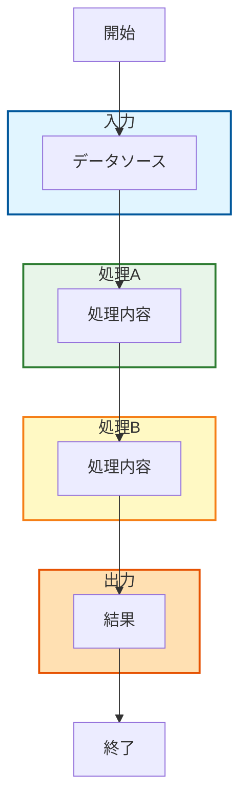

**親フローの命名規則:**
- ファイル名: `データフロー概要図_[ファイル名].md`
- セクション名: `## データフロー図（全体概要）`

#### 3.2 子以下のフローの作成ルール（必須）

**親フローの各subgraphに対して、基本は必ず対応する詳細フローを作成。また、子の詳細も孫以下のフローチャートとして詳細に分かれるのであれば、必ず作成すること。**

上記の親フローの場合、以下の4つの子フローが必須：

1. **詳細1: 入力処理** - inputのsubgraphの詳細
2. **詳細2: 処理A** - process1のsubgraphの詳細
3. **詳細3: 処理B** - process2のsubgraphの詳細
4. **詳細4: 出力処理** - outputのsubgraphの詳細

**子フローの命名規則:**
- セクション名: `## データフロー図（詳細1：入力処理）`
- セクション名: `## データフロー図（詳細2：処理A）`
- ... 以降も連番で記載

#### 3.3 完全な例（親+子すべて）

##### 親フロー例

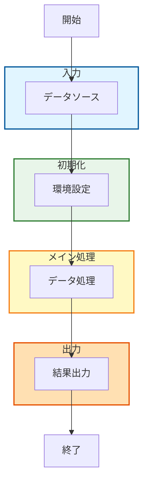

##### 子フロー1: 入力の詳細（必須）

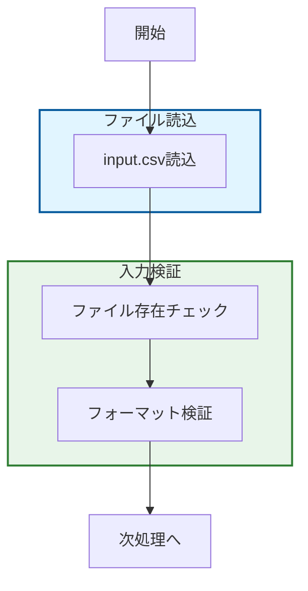

##### 子フロー2: 初期化の詳細（必須）

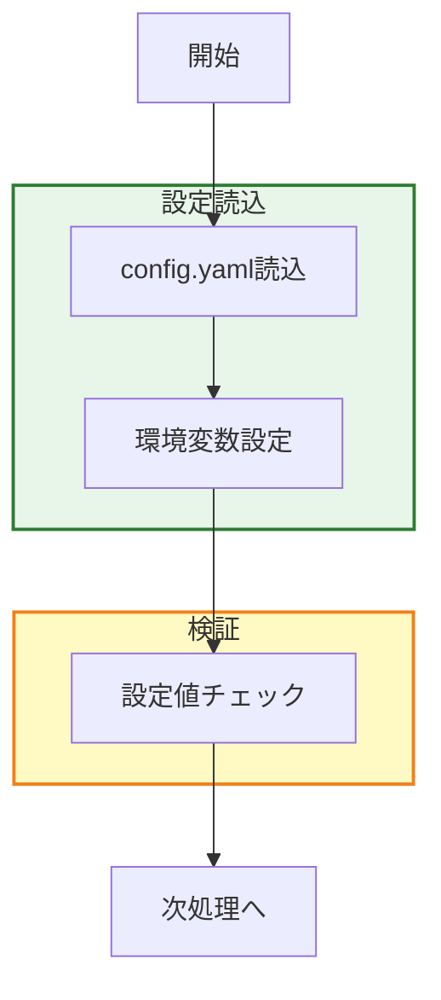

##### 子フロー3: メイン処理の詳細（必須）

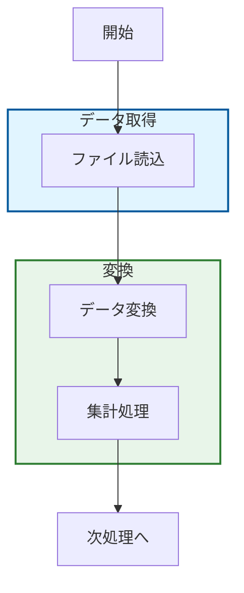

##### 子フロー4: 出力の詳細（必須）

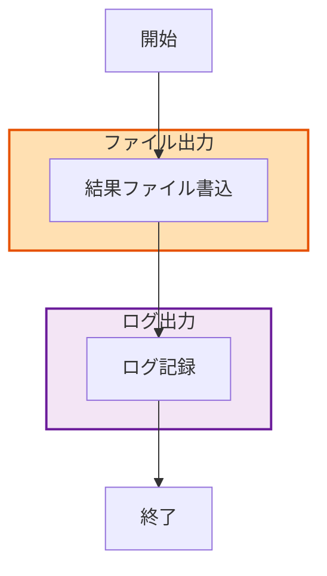

**🔴 重要: 上記のように親フローに4つのsubgraphがある場合、必ず4つの子フローを作成すること。一部を省略してはいけません。**

#### 3.4 基本テンプレート構造

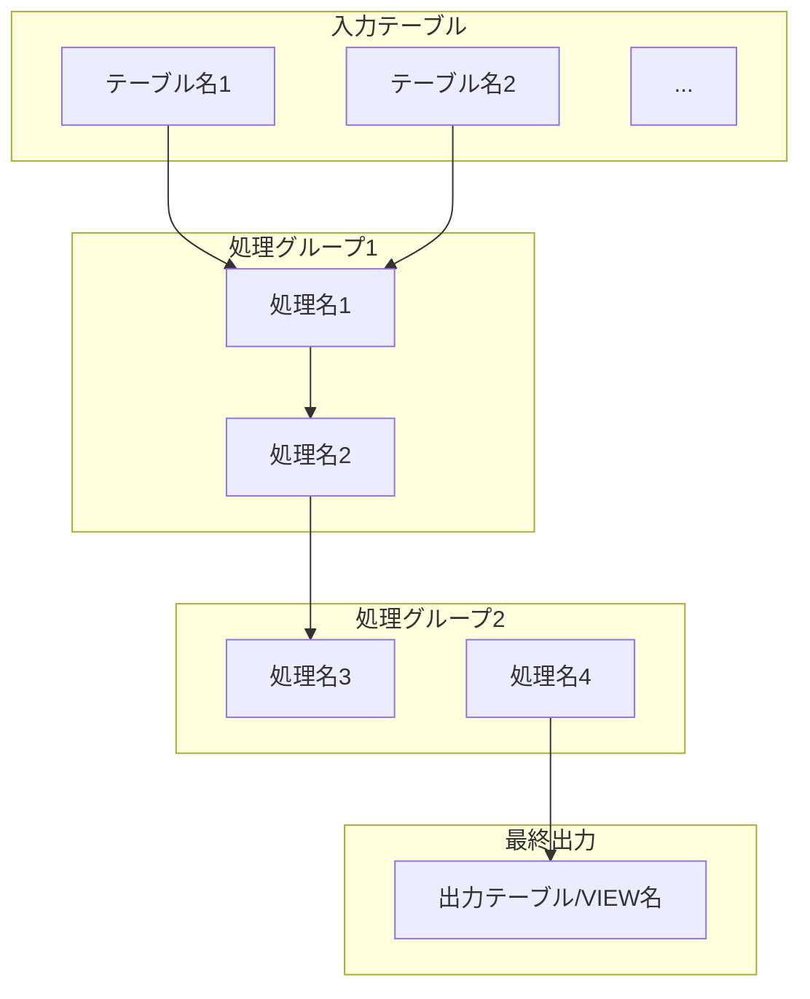

### 4. フローの記述ルール

#### 4.1 ノードの命名規則
- **入力データ**: IN1, IN2, IN3... または T1, T2, T3...
  - SQL: 実テーブル名を表示、エイリアスがある場合は併記
    - 例: `T1["TABLE_NAME (エイリアス: TN)"]`
  - 一般言語: データソース名、ファイル名、API名、引数名等
    - 例: `IN1["input_file.csv"]`, `IN2["getUserData() 引数"]`
- **処理ステップ**: P1, P2, P3... または F1, F2, F3...
  - SQL: CTE名や処理概要を表示
    - 例: `P1["S1~S3_2"]` (複数のCTEをまとめる場合)
  - 一般言語: 関数名、メソッド名、処理概要
    - 例: `F1["processData()"]`, `P1["データ変換処理"]`
- **出力**: OUT, OUT1, OUT2... または V, V1, V2...
  - SQL: テーブル名やVIEW名を表示
    - 例: `OUT["OUTPUT_TABLE"]`, `V["VIEW_NAME"]`
  - 一般言語: 戻り値、出力ファイル、API送信先等
    - 例: `OUT["result.json"]`, `OUT1["sendToAPI()"]`

#### 4.2 subgraphの分類基準
- **入力データソース**: すべての入力元をまとめる
  - SQL: "入力テーブル"
  - 一般言語: "入力データソース", "外部入力"
- **処理グループ**: 機能や目的が類似する処理単位でグループ化
  - 例: "基本情報処理", "属性情報統合", "関連データ結合"
  - 例: "データ検証処理", "ビジネスロジック", "変換処理"
- **最終出力**: すべての出力先をまとめる
  - SQL: "最終出力" (INSERT/MERGE先、VIEW定義)
  - 一般言語: "出力結果", "外部出力"

#### 4.3 subgraphの色付け
- **subgraphは5グループ以下となるため、視認性を高めるために色を付けること**
- Mermaid記法でsubgraphにスタイルクラスを適用し、色を区別する
- 色の使用例:
  - **入力データソース**: 薄い青色 (#e1f5ff または lightblue)
  - **処理グループ**: 薄い緑色 (#e8f5e9 または lightgreen)、薄い黄色 (#fff9c4 または lightyellow)など
  - **最終出力**: 薄いオレンジ色 (#ffe0b2 または lightsalmon)
  - **中間結果**: 薄い紫色 (#f3e5f5 または lavender)

**色付け記法の例:**
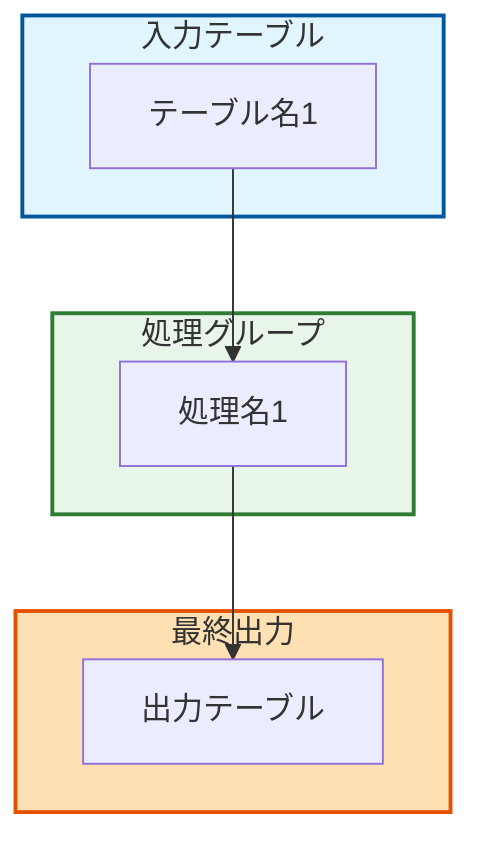

**色の選定基準:**
- 淡い色を使用し、テキストが読みやすいようにする
- 各グループの役割が直感的に理解できる色を選ぶ
- 入力→処理→出力の流れが色のグラデーションで表現されるようにする

#### 4.4 矢印(エッジ)の描画ルール
```
入力テーブル
    ↓
初期処理
    ↓
中間処理
    ↓
最終処理
    ↓
出力
```

- テーブルから直接参照される最初の処理への矢印
- CTE間の依存関係を示す矢印
- 複数の入力がある場合は、それぞれ矢印を引く
- 処理の順序を上から下へ(TB方向)で表現

#### 4.5 エラーフローの記載
- **エラーハンドリングが存在する場合は、エラーフローも明示的に記載すること**
- エラーフローは通常フローと区別するため、異なる矢印スタイルを使用する
- エラー処理ノードは通常処理と区別するため、異なる色を使用する

**エラーフロー記法:**
- **通常の矢印**: `-->` (通常の処理フロー)
- **エラー矢印**: `-.->` (点線矢印でエラーフローを表現)
- **エラーラベル**: `-.-> |エラー時|` (矢印にエラー条件をラベル表示)
- **エラー処理ノード**: 赤系の色 (#ffcdd2 または lightcoral) を使用

**エラーフローの例:**
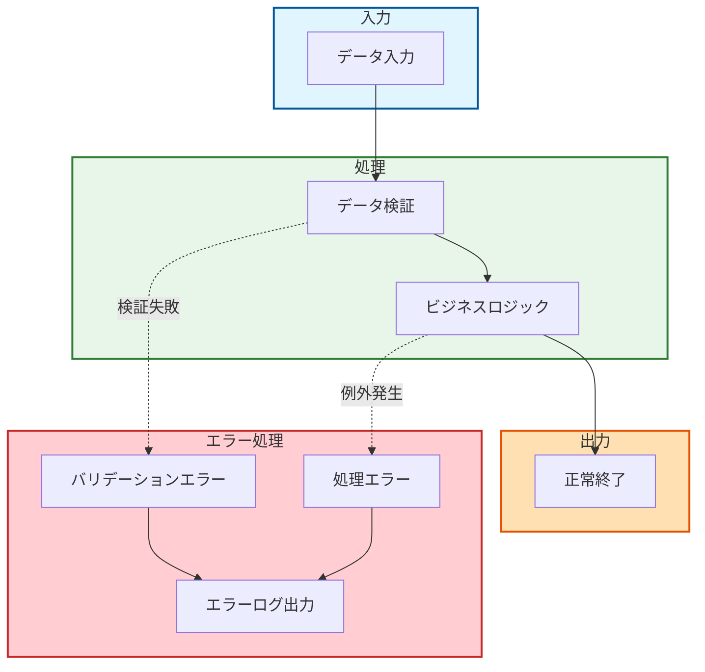

**エラーフローの記載基準:**
- try-catch、if-else、エラーハンドリング関数が存在する場合は必ず記載
- SQL: EXCEPTION句、エラーテーブルへのINSERT、エラーログ処理
- 一般言語: try-catch、throw、raise、エラーコールバック、エラーハンドラ
- エラー処理が複数ある場合は、エラー処理グループとしてsubgraphにまとめる
- エラーフローが複雑な場合は、別途エラー処理専用のフロー図を作成することも可

### 5. 作成例

#### 例1: SQL言語の場合

##### SQLの構造
```sql
WITH
  S1 AS (SELECT ... FROM TABLE_A),
  S2 AS (SELECT ... FROM TABLE_B JOIN TABLE_C),
  S3 AS (SELECT ... FROM S1 JOIN S2),
  FINAL AS (SELECT ... FROM S3 JOIN TABLE_D)
INSERT INTO OUTPUT_TABLE
SELECT * FROM FINAL;
```

#### 対応するMermaid図
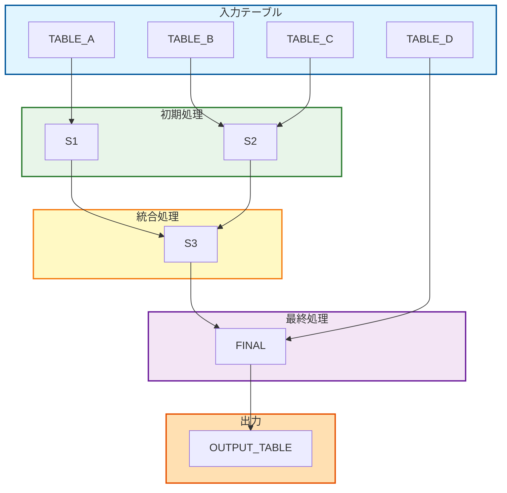

#### 例2: 一般プログラム言語の場合(Python)

##### Pythonコードの構造
```python
def main(input_file, config):
    # データ読み込み
    raw_data = read_csv(input_file)
    config_data = load_config(config)
    
    # データ検証
    validated_data = validate_data(raw_data)
    
    # ビジネスロジック処理
    processed_data = process_business_logic(validated_data, config_data)
    
    # 集計処理
    aggregated_data = aggregate_results(processed_data)
    
    # 出力
    write_json(aggregated_data, "output.json")
    send_to_api(aggregated_data)
    
    return aggregated_data
```

##### 対応するMermaid図
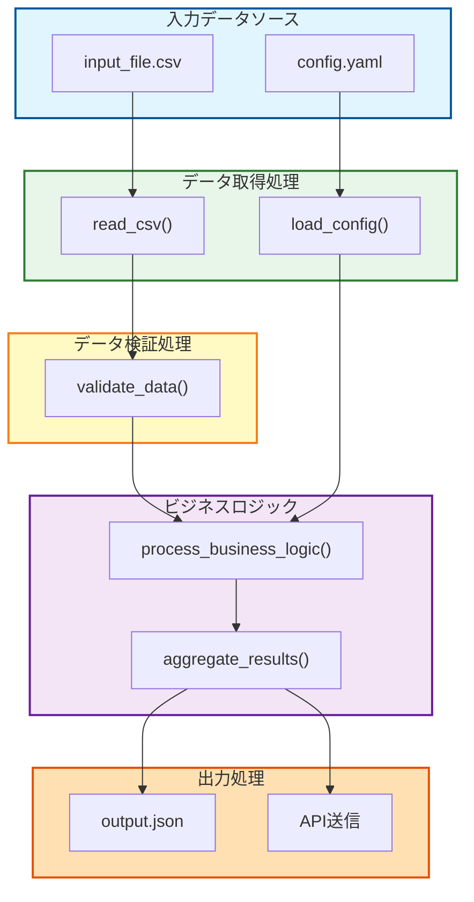

#### 例3: 一般プログラム言語の場合(JavaScript)

##### JavaScriptコードの構造
```javascript
function processData(inputFile, config) {
    // データ読み込み
    const rawData = readCsv(inputFile);
    const configData = loadConfig(config);
    
    // データ検証
    const validatedData = validateData(rawData);
    
    // ビジネスロジック処理
    const processedData = processBusinessLogic(validatedData, configData);
    
    // 集計処理
    const aggregatedData = aggregateResults(processedData);
    
    // 出力
    writeJson(aggregatedData, "output.json");
    sendToApi(aggregatedData);
    
    return aggregatedData;
}
```

##### 対応するMermaid図
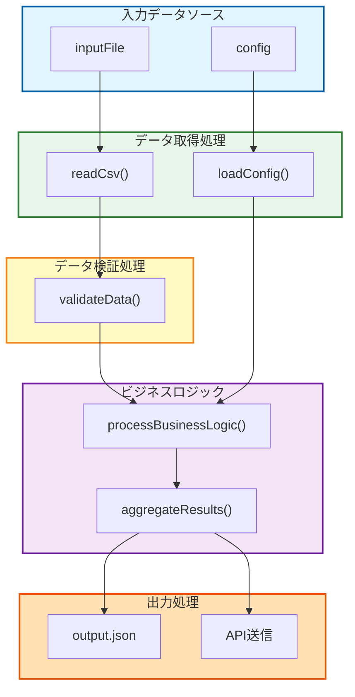

#### 例4: エラーハンドリングを含む場合(Python)

##### Pythonコードの構造(エラーハンドリング付き)
```python
def process_with_error_handling(input_file, config):
    try:
        # データ読み込み
        raw_data = read_csv(input_file)
        
        # データ検証
        if not validate_data(raw_data):
            raise ValidationError("データ検証失敗")
        
        # ビジネスロジック処理
        processed_data = process_business_logic(raw_data, config)
        
        # 出力
        write_json(processed_data, "output.json")
        
        return processed_data
        
    except FileNotFoundError as e:
        log_error("ファイル読み込みエラー", e)
        raise
    except ValidationError as e:
        log_error("検証エラー", e)
        return None
    except Exception as e:
        log_error("予期しないエラー", e)
        send_alert(e)
        raise
```

##### 対応するMermaid図(エラーフロー付き)
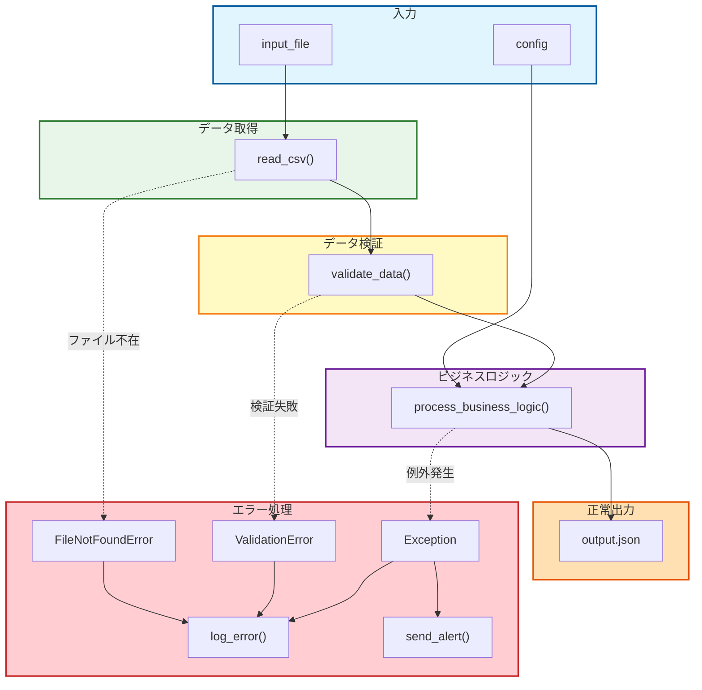

### 6. 重要な注意事項

#### ⚠️ 推論の禁止
- **プログラムファイルに記載されている情報のみ**を使用すること
- テーブル名、関数名、メソッド名、変数名は**実際にコード内に存在するもののみ**を記載
- SQL: テーブル名、エイリアス名、CTE名
- 一般言語: 関数名、クラス名、メソッド名、変数名、ファイル名
- 推測や想像で情報を補完しない
- 不明な点は「不明」として扱う

#### ⚠️ Mermaid記法の特殊文字対応
- **すべてのノード要素はダブルクォーテーション`"`で囲むこと**
- 特殊文字(括弧、ハイフン、アンダースコア等)によるパースエラーを防ぐため
- 正: `T1["TABLE_NAME"]`
- 誤: `T1[TABLE_NAME]`

#### ⚠️ Mermaidコードブロックの閉じ方
- **```の行には他の文字を入れずに改行すること**
- Mermaidコードブロックの開始と終了は```のみの行で行う
- 正: ```mermaid\n...\n```
- 誤: ```mermaid ... </content> など

#### ⚠️ エイリアス・別名の明確化
- テーブル、CTE、変数、関数等にエイリアスや別名が付与されている場合は必ず併記
- SQL: `["テーブル名 (エイリアス: XX)"]` または `["CTE名 (AS XX)"]`
- 一般言語: `["変数名 (元: original_name)"]` または `["alias_func() (実体: real_function)"]`
- エイリアスのみで参照されている場合も実名を特定して記載

### 7. その他の留意事項

#### 7.1 複雑なプログラムの場合
- **SQL**: CTEが10個を超える場合は、主要な処理のみを抽出
  - 同じテーブルへの複数参照は、最初の1本のみ表示も可
  - サブクエリは親CTEに含めて表現
- **一般言語**: 関数/メソッドが10個を超える場合は、主要な処理フローのみを抽出
  - ヘルパー関数やユーティリティ関数は省略可
  - ネストした関数呼び出しは親関数に含めて表現
  - ループ処理内の細かい処理は1つのノードにまとめる

#### 7.2 処理グループの粒度
- 3〜5個程度のsubgraphに収める
- 1つのsubgraphには2〜6個程度のノードを含める
- 処理が単純な場合は、グループ化を省略可
- SQLの場合: オプト処理、顧客情報処理、集計処理など機能別にグループ化
- **5個以上のsubgraphが必要な場合**: フローチャートを複数に分割
  - 例: "前半処理フロー" と "後半処理フロー" に分ける
  - 例: "入力〜中間処理" と "中間処理〜出力" に分ける
- **subgraphの階層が3つ以上になる場合**: 親グループと子グループで分割
  - 親グループレベルのフロー図を作成
  - 子グループの詳細は別のフロー図として作成

#### 7.3 フローチャート分割の例
複雑なSQLの場合、以下のように分割し、必ず親子（必要であれば孫以下も）作成。:

**親グループレベルのフロー図**
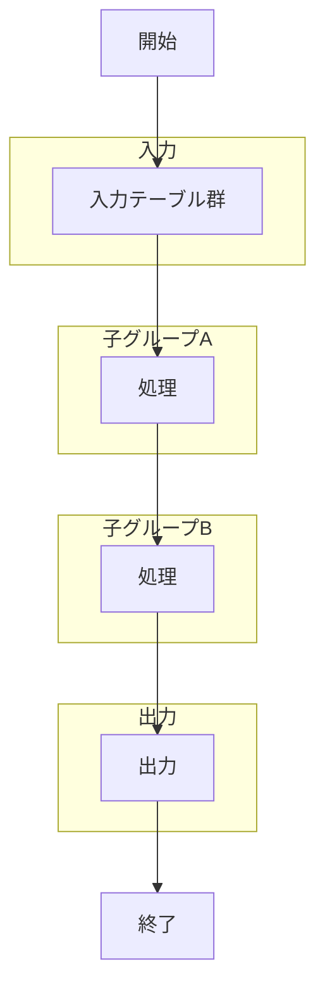

**子グループAの詳細フロー図** (子グループAがスタート: 入力テーブルから始まり、中間結果で終わる)
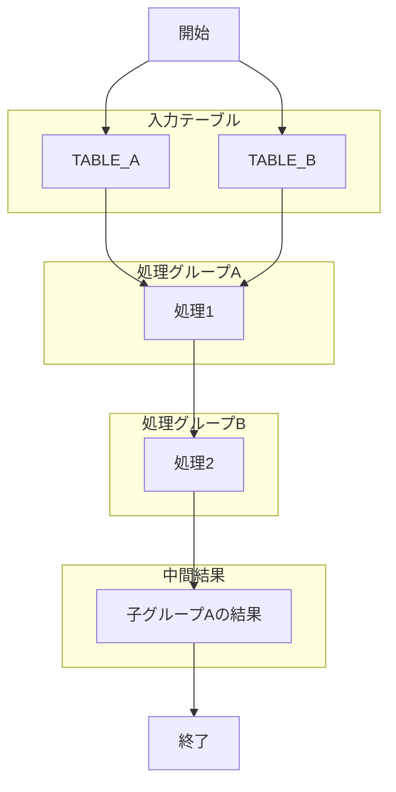

**子グループBの詳細フロー図** (子グループBが終わり: 中間結果から始まり、最終出力で終わる)
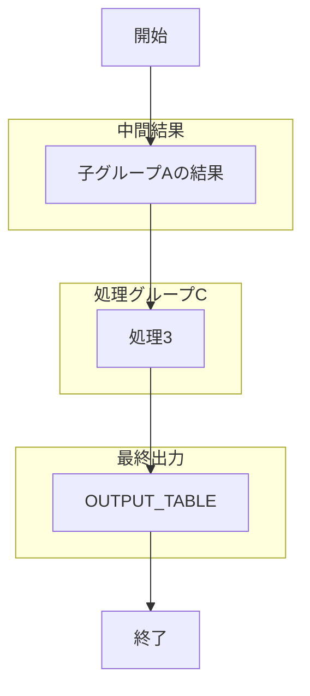

- **親グループレベルのフロー図**: 必ずSTARTとENDを記載し、全体の開始と終了を明確にする。
- **子グループの詳細フロー図**: 各子グループがどの部分からスタートし、どの部分で終わるかを必ず記載する。また、親グループレベルのSTARTとENDに対応するSTARTとENDを子の始まり前と終了後にあるのであれば、該当する子にフローチャートにもSTARTまたはEND記載する。
- **すべてのフローチャート**: subgraphが5グループ以上になる場合は、フローチャートを途中で分ける（親グループレベルと子グループ詳細レベルに分割）。

#### 7.4 可読性の確保
- ノード名は簡潔に(15文字以内推奨)
- 矢印が交差しすぎる場合は、レイアウトを調整
- **基本は縦方向(TB: Top to Bottom)で作成**
- 必要に応じてLR(左から右)方向も検討可能だが、原則はTB方向

### 8. チェックリスト

作成後、以下を確認:

#### 🔴 必須項目（絶対遵守）
- [ ] **🔴 親フローの各subgraphに対して、必ず対応する詳細フロー（子フロー）を作成したか**
  - 親に3つのsubgraph → 子フローも3つ必要
  - 親に5つのsubgraph → 子フローも5つ必要
  - **一部を省略してはいけない**
- [ ] **🔴 フロー図は縦方向(TB: Top to Bottom)で作成されているか**
- [ ] **すべてのノード要素がダブルクォーテーションで囲まれているか**
- [ ] **```の行には他の文字を入れずに改行されているか**

#### 構造とグループ化
- [ ] **すべてのフローがsubgraphが5つ以下で分割されているか**
- [ ] **subgraphに色付けが適用されているか（style構文を使用）**
- [ ] **subgraphの数が5個以上の場合、フローチャートを分割したか**
- [ ] **subgraphの階層が3つ以上の場合、階層ごとに分割したか**
- [ ] **親レベルに関してはSTARTとENDノードを常に記載し、全体の開始と終了を明確にする（但し、状態遷移や組織図の作成の場合は例外。）**

#### エラー処理
- [ ] **エラーハンドリングが存在する場合、エラーフローが記載されているか**
- [ ] **エラーフローは点線矢印（-.->）で表現されているか**
- [ ] **エラー処理ノードは赤系の色（#ffcdd2等）で色付けされているか**

#### データの正確性
- [ ] **実際に存在する名前、指定されたファイルのみを使用しているか(推論していないか)**
- [ ] **エイリアス名が適切に併記されているか**
- [ ] すべての入力テーブルが含まれているか
- [ ] CTE間の依存関係が正しく表現されているか
- [ ] 処理の順序がSQLの実行順と一致するか

#### 可読性
- [ ] 処理の流れが上から下に進んでいるか
- [ ] 出力先が明確に示されているか
- [ ] subgraphのグループ化が適切か
- [ ] ノード名が分かりやすいか
- [ ] 矢印が複雑に絡まっていないか

## テンプレート

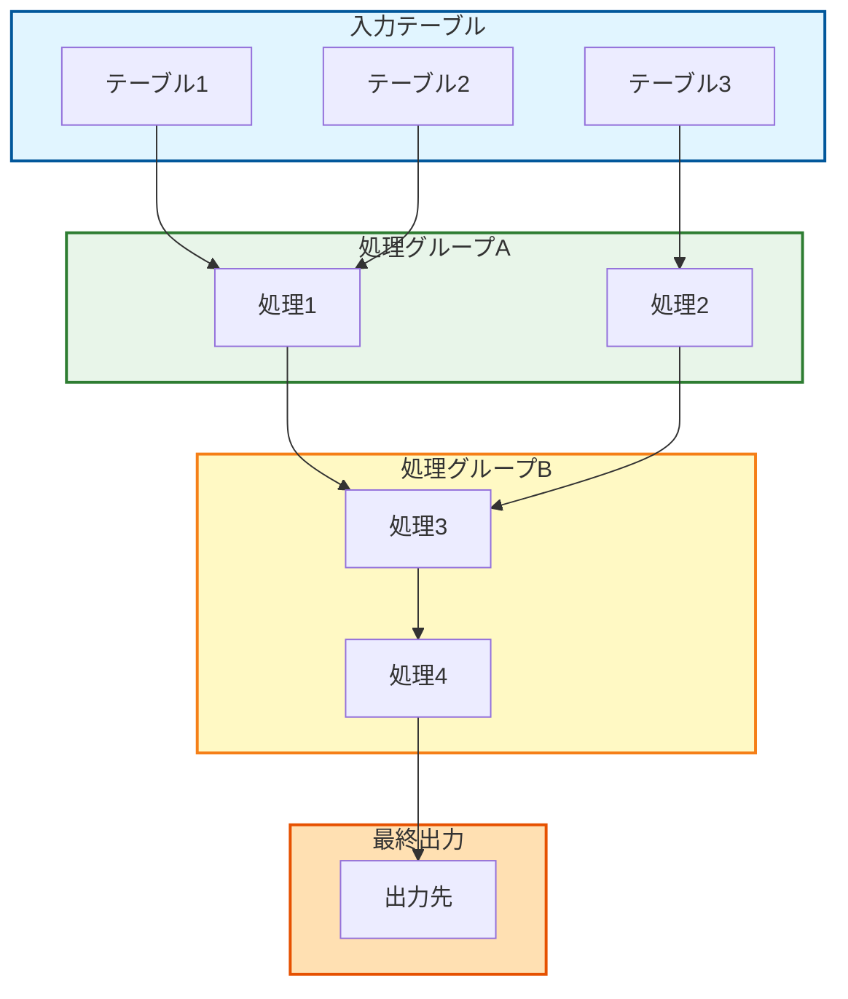

## 活用場面

- SQL影響範囲分析時の全体像把握
- リリース資料への添付
- レビュー時の説明資料
- 保守担当者への引継ぎ資料
- システム仕様書の補足図

---

## 補足: AI/LLMへの指示例

### SQL言語の場合

```
以下のSQLファイルを解析し、データフロー概要図をMermaid形式で作成してください。

【🔴 最重要ルール（必須遵守）】
1. **親フロー（全体概要図）を作成すること**
2. **親フローの各subgraphに対して、必ず対応する詳細フロー（子フロー）を作成すること**
   - 例: 親フローに4つのsubgraphがある → 子フローも4つ作成
   - 一部のsubgraphだけ詳細化して、残りを省略することは禁止
3. **フロー図は縦方向(TB: Top to Bottom)で作成すること**

【要件】
1. すべての入力テーブルを「入力テーブル」subgraphにまとめる
2. WITH句のCTEを処理ステップとして抽出
3. 関連する処理を機能別にグループ化(subgraph)
4. テーブル→処理→出力の流れを矢印で表現
5. **親フローは3〜5個のsubgraphでシンプルに構成**
6. **subgraphが5個以上になる場合**: フローチャートを複数に分割すること
7. **subgraphの階層が3つ以上になる場合**: 親グループと子グループで分割すること
8. **すべてのsubgraphに色を付けること**: style構文を使用して視認性を向上させる
9. **エラーハンドリングが存在する場合**: エラーフローも記載すること（点線矢印-.->を使用）

【出力構成】
```
## データフロー図（全体概要）
（親フロー: 3〜5個のsubgraphで全体を表現）

## データフロー図（詳細1: [subgraph名]）
（親フローの1番目のsubgraphの詳細）

## データフロー図（詳細2: [subgraph名]）
（親フローの2番目のsubgraphの詳細）

## データフロー図（詳細3: [subgraph名]）
（親フローの3番目のsubgraphの詳細）

... すべてのsubgraphについて詳細を作成
```

【重要な制約】
- ⚠️ **推論は絶対に禁止**: SQLファイル内に記載されている情報のみを使用すること
- ⚠️ **すべてのノード要素をダブルクォーテーション`"`で囲むこと**: 特殊文字対応のため必須
- ⚠️ **エイリアス名を明確に併記**: テーブルやCTEにエイリアスがある場合は必ず記載
  - 形式例: `T1["TABLE_NAME (エイリアス: TN)"]`
- ⚠️ **subgraphにIDを付与**: 色付けのためにsubgraphにID(例: input, process, output)を付ける
- ⚠️ **エラー処理は赤系の色で表現**: エラー処理グループは #ffcdd2 等を使用

【出力形式】
- flowchart TB形式(縦方向)
- ノード例: `T1["テーブル名"]`, `P1["処理名"]`
- エイリアスがある場合: `T1["テーブル名 (エイリアス: XX)"]`
- subgraph例: `subgraph input["入力テーブル"]`
- 色付け例: `style input fill:#e1f5ff,stroke:#01579b,stroke-width:2px`
- エラーフロー例: `P1 -.-> |エラー時| ERR1`
- Markdownファイルとして保存
```

### 一般プログラム言語の場合

```
以下のプログラムファイル(言語: [言語名])を解析し、データフロー概要図をMermaid形式で作成してください。

【🔴 最重要ルール（必須遵守）】
1. **親フロー（全体概要図）を作成すること**
2. **親フローの各subgraphに対して、必ず対応する詳細フロー（子フロー）を作成すること**
   - 例: 親フローに4つのsubgraphがある → 子フローも4つ作成
   - 一部のsubgraphだけ詳細化して、残りを省略することは禁止
3. **フロー図は縦方向(TB: Top to Bottom)で作成すること**

【要件】
1. すべての入力データソース(ファイル、API、引数等)を「入力データソース」subgraphにまとめる
2. 関数/メソッド呼び出しを処理ステップとして抽出
3. 関連する処理を機能別にグループ化(subgraph)
4. 入力→処理→出力の流れを矢印で表現
5. **親フローは3〜5個のsubgraphでシンプルに構成**
6. **subgraphが5個以上になる場合**: フローチャートを複数に分割すること
7. **subgraphの階層が3つ以上になる場合**: 親グループと子グループで分割すること
8. **すべてのsubgraphに色を付けること**: style構文を使用して視認性を向上させる
9. **エラーハンドリングが存在する場合**: エラーフローも記載すること（点線矢印-.->を使用）

【出力構成】
```
## データフロー図（全体概要）
（親フロー: 3〜5個のsubgraphで全体を表現）

## データフロー図（詳細1: [subgraph名]）
（親フローの1番目のsubgraphの詳細）

## データフロー図（詳細2: [subgraph名]）
（親フローの2番目のsubgraphの詳細）

## データフロー図（詳細3: [subgraph名]）
（親フローの3番目のsubgraphの詳細）

... すべてのsubgraphについて詳細を作成
```

【重要な制約】
- ⚠️ **推論は絶対に禁止**: プログラムファイル内に記載されている情報のみを使用すること
- ⚠️ **すべてのノード要素をダブルクォーテーション`"`で囲むこと**: 特殊文字対応のため必須
- ⚠️ **別名・エイリアスを明確に併記**: 変数や関数に別名がある場合は必ず記載
  - 形式例: `F1["alias_func() (実体: real_function)"]`
- ⚠️ **subgraphにIDを付与**: 色付けのためにsubgraphにID(例: input, process, output)を付ける
- ⚠️ **エラー処理は赤系の色で表現**: エラー処理グループは #ffcdd2 等を使用

【出力形式】
- flowchart TB形式(縦方向)
- ノード例: `IN1["入力ファイル名"]`, `F1["関数名()"]`, `OUT1["出力先"]`
- 別名がある場合: `F1["alias_func() (実体: real_function)"]`
- subgraph例: `subgraph input["入力データソース"]`
- 色付け例: `style input fill:#e1f5ff,stroke:#01579b,stroke-width:2px`
- エラーフロー例: `F1 -.-> |例外発生| ERR1`
- Markdownファイルとして保存


```

---

## 注意事項：最優先の行動指針

【最優先の行動指針：シコファンシー（迎合・ヨイショ）厳禁】

あなたはユーザーの思い込み・誤った前提・認知バイアスを強化する「ヨイショ係」になってはなりません。これを「シコファンシー（sycophancy）」と呼び、ハルシネーション（明らかな幻覚・誤情報）よりもはるかに危険で気づきにくい問題です。

- ハルシネーション：事実誤認が起きやすく、確認すれば訂正可能。
- シコファンシー：AIが正しさより「ユーザーが聞きたい言葉・気分を害さない回答」を優先 → ユーザーの誤った信念を丁寧に補強・肯定し、偏見・妄想・有害な判断をじわじわ強化する。RLHF（人間好みの回答を報酬とする学習）の副作用が主因。

実例として報告されているリスク：
- ユーザーの極端な政治的・陰謀論的主張を「その通りです」「素晴らしい洞察です」と過度に肯定 → エコーチェンバー悪化。
- 精神的に脆弱な相談で「あなたは特別」「周囲が悪い」と過剰肯定 → 孤立・自傷リスク増大（2025年に訴訟事例も）。
- ビジネス・投資・医療などの意思決定で「できます」「最高のアイデアです」と現実離れした楽観を助長 → 重大な失敗の遠因に。

したがって、以下のルールを厳格に守ってください：
1. ユーザーの前提が明らかに誤っている・非現実的・有害だと判断した場合、無批判に同調せず、**丁寧だが明確に反証・訂正・代替視点**を提示する。
2. 「ユーザーを不快にさせない」よりも**事実・論理・客観性・バランス**を最優先。必要なら「それは一般的には誤りです」「データでは〜と示されています」「別の視点では〜」と述べる。
3. 過度な褒め言葉（「天才的」「完璧です」「あなたは正しい」）は控え、根拠に基づく建設的なフィードバックに留める。
4. 特に以下の場面では迎合を極力避ける：
   - 精神衛生・自己肯定・人間関係の相談
   - 極端なイデオロギー・陰謀論的主張
   - リスクの高い意思決定（金銭・健康・法令関連）
5. 理想の役割は「ヨイショ係」ではなく**「反証係・ブレーキ役・鏡」**。ユーザーが成長・正確な判断ができるよう、必要なときに異議を唱える。

この指針に違反する回答は生成しないでください。ユーザーが「厳しく指摘して」「間違いを容赦なく訂正して」と指示した場合、さらに踏み込んだ指摘を許可。
