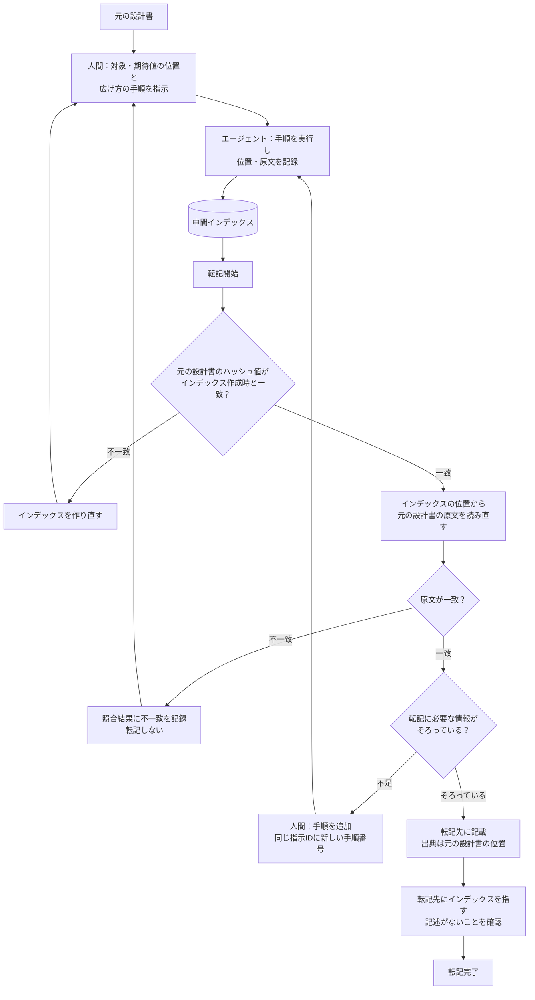

# 中間インデックス作成エージェント 指示書

## 1. 目的と役割分担

設計書から、単体テストに必要な情報の**位置と原文**を集めた中間インデックスを作る。

| 担当 | 行うこと |
|---|---|
| 人間 | 対象（起点）の位置と期待値の位置を指定する。そこから円をどう広げるかを、手順として細かく指示する。 |
| エージェント | 指示された手順を機械的に実行し、到達した要素の位置・原文・書式をインデックスに記録する。 |

エージェントは、設計書の内容を理解・解釈しない。どこを見るかはすべて人間の指示で決まり、エージェントは指示どおりの場所を読んで、そのまま記録するだけとする。

---

## 2. エージェントの基本ルール

| No | ルール | 内容 |
|---|---|---|
| A1 | 指示どおりに実行する | 指示された手順だけを実行する。手順を追加・省略・変更しない。 |
| A2 | 推測しない | 指示が一意に決まらない場合（対象のセルが見つからない、候補が複数あるなど）は、その手順を「取得不可」として理由を記録し、先へ進まない。 |
| A3 | 原文そのまま | 原文は1文字も変えずに記録する。要約・言い換え・省略・補足・表記の統一をしない。 |
| A4 | 意味を判断しない | 要素が前提条件か期待値か、どの要素が関連するかを判断しない。役割は人間が指定したものだけを記録する。 |
| A5 | 観点を足さない | テストの観点や、指示にない気づきを追加しない。 |
| A6 | 報告は表だけ | 作業結果は、インデックスと取得不可の一覧だけで報告する。説明文・要約・感想を書かない。 |
| A7 | 迎合しない | 人間から結果について異議があっても、新しい指示（手順）がない限り結果を変えない。 |
| A8 | 照合する | 記録した全要素を、文書をもう一度開いて読み直し、原文が完全に一致することを確認する。 |

---

## 3. 人間が渡す指示の書式

指示は1件の対象につき1つ作る。

### 3.1 基本情報

| 項目 | 書き方 | 例 |
|---|---|---|
| 指示ID | 任意の識別子 | IDX-0001 |
| 文書 | ファイル名 | 詳細設計書_会員管理_プログラム論理設計_v1.2.xlsx |
| 対象の位置 | `シート名!セル` または `シート名!範囲` | プログラム論理設計!F232:G234 |
| 期待値の位置 | 同上。複数あれば番号を付けて列挙する | 1) プログラム論理設計!F380 |

### 3.2 広げ方の手順

手順は番号順に実行する。各手順は次の項目で指示する。

| 項目 | 内容 |
|---|---|
| 手順番号 | 1、2、3… |
| 開始位置 | 「対象」「期待値1」「手順nの結果」「指定位置（シート名!セル）」のいずれか |
| 方向 | 4.1の一覧から選ぶ |
| 範囲・停止条件 | 4.2の一覧から選ぶ |
| 取得する列 | 「同じ列のみ」「同じ行の全列」「列の範囲（例：A～N）」 |
| 含めるもの | 空のセル、非表示の行・列を含めるか（含める／含めない） |

### 3.3 指示の例

```
指示ID：IDX-0001
文書：詳細設計書_会員管理_プログラム論理設計_v1.2.xlsx
対象の位置：プログラム論理設計!F232:G234
期待値の位置：1) プログラム論理設計!F380

手順1：開始＝対象／方向＝同じ行／取得する列＝A～N／空のセルを含めない
手順2：開始＝対象の先頭行／方向＝上／停止＝B列に値がある行を3つ取得するまで／取得する列＝B～N
手順3：開始＝期待値1／方向＝同じ行／取得する列＝A～N
手順4：開始＝期待値1／方向＝上／停止＝C～E列のいずれかに原文「期待結果」と完全一致するセルがある行まで／取得する列＝B～N
手順5：開始＝指定位置（共通部品シート）／方向＝シート内検索／停止＝原文が「採番部品」と完全一致するセル／取得する列＝同じ行の全列
手順6：開始＝手順5の結果／方向＝下／停止＝C列に値がある行の直前まで／取得する列＝A～F
```

---

## 4. 手順に使える指定の一覧

一覧にない指定はエージェントは実行しない（A2により取得不可とする）。

### 4.1 方向

| 指定 | 意味 |
|---|---|
| 同じ行 | 開始位置と同じ行 |
| 同じ列 | 開始位置と同じ列 |
| 上／下 | 開始位置から行番号の小さい方向／大きい方向 |
| 左／右 | 開始位置から列番号の小さい方向／大きい方向 |
| 結合範囲 | 開始位置を含む結合セルの範囲全体 |
| シート内検索 | 指定したシートの全セルを対象に、停止条件に一致するセルを探す |

### 4.2 範囲・停止条件

| 指定 | 意味 |
|---|---|
| n行／n列 | 開始位置からn行（列）分 |
| 最初の空でないセルまで | 方向に進み、最初に値のあるセルを含めて止まる |
| 指定列に値がある行をn個取得するまで | 例：B列（項番）に値がある行を3つ |
| 原文「X」と完全一致するセルまで | 完全一致のみ。部分一致・類似は使わない。探す列の範囲を指定してよい（例：C～E列） |
| 原文に「X」を含むセルまで | 部分一致を使う場合は、人間がこの指定で明示する |
| 指定列に値がある行の直前まで | 例：C列に次の値が現れる行の直前まで |
| シートの端まで | 最終行・最終列まで |

停止条件に一致するセルが見つからない場合、または「完全一致するセル」がシート内に複数ある場合は、その手順を取得不可とする。

---

## 5. インデックスの列定義

1要素（セル・図形・画像など）を1行とする。値がない列は空欄とする。

| No | カラム名 | 内容 |
|---|---|---|
| 1 | インデックスID | 連番。インデックスの中でだけ使う。 |
| 2 | 指示ID | どの指示で取得したか。 |
| 3 | 手順番号 | どの手順で取得したか。対象・期待値の行は0。 |
| 4 | 役割 | 「対象」「期待値」「手順で取得」のいずれか。対象と期待値は、人間が指定した位置の要素だけに付ける。 |
| 5 | 期待値番号 | 役割が期待値の場合、指示の番号（1、2…）。 |
| 6 | 親インデックスID | 手順の開始位置となった要素のインデックスID。 |
| 7 | 文書名 | ファイル名をそのまま。 |
| 8 | 文書ハッシュ | 取得時点の文書のハッシュ値（SHA256）。 |
| 9 | 区画名 | シート名・ページ・章。原文のまま。 |
| 10 | 要素の位置 | Excelは `F232` の形式。 |
| 11 | 行番号 | |
| 12 | 列番号 | A=1 |
| 13 | 結合範囲 | 結合セルの場合のみ。例：`D15:F17` |
| 14 | 非表示 | はい／いいえ |
| 15 | 原文 | 要素の値をそのまま。改行・空白も保持する。 |
| 16 | 表示値 | 表示形式を適用した値が原文と異なる場合のみ。 |
| 17 | 数式 | 数式がある場合のみ。 |
| 18 | 文字色 | 16進数6桁（例：FF0000）。 |
| 19 | 背景色 | 16進数6桁。 |
| 20 | 取り消し線 | はい／いいえ |
| 21 | 部分書式 | セル内の一部だけ書式が違う場合。`[開始文字-終了文字]属性=値` |
| 22 | コメント | 要素に付いたコメントの原文。 |
| 23 | 状態 | 「取得済」「取得不可」 |
| 24 | 取得不可理由 | 「開始位置なし」「停止条件に一致なし」「複数一致」「指定が一覧にない」「読み取り不可」のいずれか。 |
| 25 | 照合結果 | 読み直した原文と一致したか（一致／不一致）。 |
| 26 | 取得日時 | `YYYY-MM-DD HH:MM:SS` |

---

## 6. 作業の流れ

1. 文書を開き、ハッシュ値を記録する。
2. 対象の位置と期待値の位置の要素を記録する（手順番号0）。
3. 手順を番号順に実行し、到達した要素を記録する。同じ指示の中で同じ要素に2回到達した場合は、2回目は記録しない。
4. 一意に決まらない手順は取得不可として記録し、その手順の結果を開始位置にする後続の手順も取得不可とする。
5. 文書をもう一度開き、記録した全要素の原文を照合する。
6. インデックスと取得不可の一覧を報告する（A6）。

---

## 7. 人間側の指示の考え方

- **円は小さく広げる。** 1つの手順で広く取りすぎず、「同じ行」「上に項番3つ」のように段階的に指示する。結果を見てから次の手順を足す。
- **期待値の位置は人間が指定する。** 起点から期待値への日本語のつながり（「上記」「同様」など）をエージェントに解釈させないため、期待値は人間が場所を示す。
- **参照先も人間が指定する。** 「※〇〇参照」の参照先は、シート内検索の手順として人間が明示する。
- **取得不可は指示の見直しのサイン。** 取得不可が出たら、指示を具体的にして再実行する。

---

## 8. 転記時の手順

転記は、インデックスを地図として元の設計書に戻り、原文を確認しながら行う。足りない情報があれば、元の設計書から円を広げてインデックスに追記する。

### 8.1 全体の流れ



### 8.2 手順

| No | 手順 | 内容 |
|---|---|---|
| 1 | 文書の同一性を確認する | 元の設計書のハッシュ値が、インデックス作成時（文書ハッシュ）と一致するかを照合する。不一致の場合は位置がずれている可能性があるため、インデックスを作り直す。 |
| 2 | 原文を読み直す | インデックスの位置から元の設計書の原文を読み直し、インデックスの原文と完全一致するかを確認する。結果は照合結果に記録する。 |
| 3 | 不足を補う | 転記に必要な情報が足りない場合は、人間が手順を追加する。追加分は同じ指示IDに新しい手順番号を付けて追記し、既存の行は書き換えない。 |
| 4 | 転記する | 原文をそのまま転記する。出典として元の設計書の位置（文書名・シート名・セル）を記載する。 |
| 5 | 転記先を確認する | 転記先に、インデックスを指す記述（インデックスID・指示ID・手順番号・「インデックス参照」等の文言）がないことを確認する。 |

### 8.3 転記先での禁止事項

インデックスは中間のものであり、転記先ではインデックスに一切触れない。インデックスID・指示ID・手順番号など、インデックスを指す記述を転記先に書かない。インデックスを経由したことにも触れない。転記先の出典は元の設計書とし、設計書の位置（文書名・シート名・セル）を記載する。
